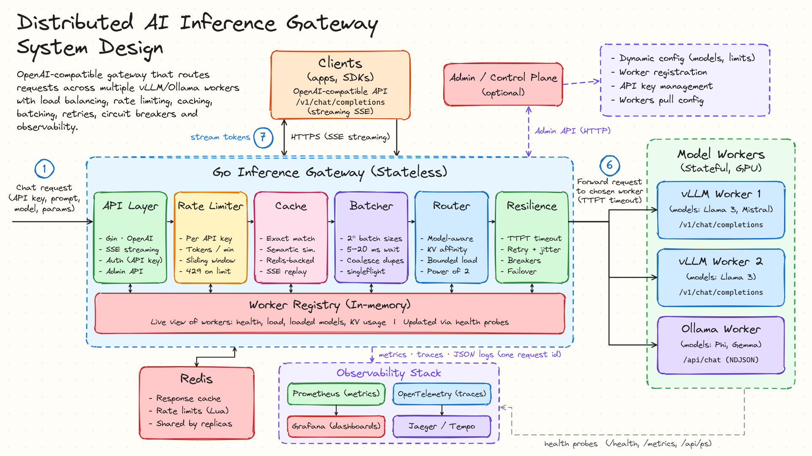

# Distributed AI Inference Gateway

An OpenAI-compatible gateway, written in Go, that routes `/v1/chat/completions`
(JSON and SSE streaming) across a fleet of **vLLM** and **Ollama** GPU workers.
The pipeline handles token-level rate limiting, exact and semantic response
caching, micro-batching, **KV-cache-aware routing**, timeouts, retries, circuit
breakers and failover, and exports metrics, traces and correlated logs.



▶ **[Watch the 2-minute motion-graphics walkthrough](docs/media/architecture-walkthrough.mp4)**
(source in [`video/`](video/))

## Why a gateway?

Inference at scale runs into three problems that a plain load balancer cannot solve:

1. **Cold KV cache on every request.** A worker that hasn't seen the prompt
   prefix recomputes prefill from scratch. Routing repeat prefixes to the
   worker that already holds them is the single biggest throughput lever.
2. **Heterogeneous models, homogeneous interface.** Llama 3 for reasoning,
   Mistral for speed, Phi for cost. Clients shouldn't care: they call one
   OpenAI-compatible endpoint and the gateway finds the right pool.
3. **Partial failures cascade.** One slow worker shouldn't stall the fleet.
   First-token timeouts, retries with jitter, circuit breakers (consecutive
   5xx *or* latency breach) and automatic failover keep p99 honest.

## What's inside

| Stage | Highlights | Package |
|---|---|---|
| **API layer** | Gin; OpenAI schema (string or array content, `developer` role, `max_completion_tokens`), SSE with `stream_options.include_usage`, OpenAI error envelope and `x-ratelimit-*` headers, API keys stored as SHA-256 digests | [`internal/api`](internal/api), [`pkg/openai`](pkg/openai), [`internal/auth`](internal/auth) |
| **Rate limiter** | Per key, **tokens/min and requests/min**, 60-bucket sliding window; reserves prompt + `max_tokens` and reconciles to actual usage; in-memory or **Redis + Lua** for fleet-wide limits | [`internal/ratelimit`](internal/ratelimit) |
| **Cache** | Exact tier + **semantic tier** (final user turn embedded, cosine similarity over SimHash/LSH buckets with 1-bit multi-probe) scoped to an identical model/params/conversation namespace; Redis or memory; hits replay as SSE | [`internal/cache`](internal/cache) |
| **Batcher** | Per-model micro-batches, **power-of-two** target sized from the arrival rate, **5–20 ms** max wait, zero added latency at low traffic; **singleflight** coalescing of identical in-flight requests with live fan-out | [`internal/batcher`](internal/batcher) |
| **Router** | Model-aware candidates, warm-model preference, **sticky conversations + bounded-load rendezvous hashing** on the shared prefix, power-of-two-choices fallback | [`internal/router`](internal/router) |
| **Resilience** | Request timeout + per-attempt **first-token timeout**, retries before the first byte only with full-jitter backoff, per-worker **circuit breakers**, failover excluding failed workers | [`internal/resilience`](internal/resilience), [`internal/gateway`](internal/gateway) |
| **Registry** | In-memory live view of workers (health, running/waiting, KV usage, prefix hit rate, GPU util, TTFT p50/p99) refreshed by probes of vLLM `/health` `/v1/models` `/metrics` and Ollama `/api/tags` `/api/ps` | [`internal/registry`](internal/registry), [`internal/backend`](internal/backend) |
| **Control plane** | Worker registration + heartbeats, workers **pull their model assignment at startup**, API keys, live model catalog/aliases and limits, hot-reloaded YAML | [`internal/admin`](internal/admin), [`internal/catalog`](internal/catalog), [`internal/config`](internal/config) |
| **Observability** | Prometheus metrics + Grafana dashboard, OpenTelemetry spans gateway → rate limit → cache → batcher → worker attempt → first token → stream complete (OTLP to Jaeger/Tempo), JSON logs with `request_id`/`trace_id` on every line and every hop | [`internal/observability`](internal/observability) |

Design notes: [architecture](docs/architecture.md) ·
[routing and KV-cache locality](docs/routing-and-kv-cache.md) ·
[operations, metrics and runbook](docs/operations.md).

## KV-cache locality, measured

`make bench-affinity` replays 96 four-turn conversations (24 shared ~1,600-token
system prompts, 32 concurrent) against three simulated vLLM workers with a
tight KV cache, once with prefix-affinity routing and once with plain
least-loaded routing:

| | Prefix affinity | Least-loaded |
|---|---|---|
| Prefix (KV) cache hit rate | **61–81 %** | 18–27 % |
| TTFT p50 | **48 ms** | 1,034 ms |
| Completion throughput | **799 tok/s** | 576 tok/s |

The simulator models prefill cost over a block-level LRU prefix cache
([`internal/mockworker`](internal/mockworker)); point the gateway at real
vLLM workers (`--enable-prefix-caching`) to measure your own fleet. See
[routing-and-kv-cache.md](docs/routing-and-kv-cache.md) for the method.

## Quick start

Requires Go 1.23+.

```bash
make run-workers   # simulated vLLM ×2 (:8001, :8002) and Ollama (:8003)
make run           # gateway on :8080 with configs/gateway.yaml
```

```bash
curl -N http://localhost:8080/v1/chat/completions \
  -H 'Authorization: Bearer sk-local-dev' -H 'Content-Type: application/json' \
  -d '{"model":"gpt-4o-mini","stream":true,"messages":[
        {"role":"system","content":"You are terse."},
        {"role":"user","content":"Why does KV cache reuse matter?"}]}'
```

`gpt-4o-mini` is an alias for `llama3-8b`; the response headers show how it
was served:

```
X-Gateway-Worker: vllm-2
X-Gateway-Route: affinity_hash
X-Gateway-Cache: bypass
X-Ratelimit-Remaining-Tokens: 1998350
X-Request-ID: 6f1c…
```

Any OpenAI SDK works unchanged:

```python
from openai import OpenAI
client = OpenAI(base_url="http://localhost:8080/v1", api_key="sk-local-dev")
for chunk in client.chat.completions.create(model="phi3", stream=True,
        messages=[{"role": "user", "content": "hello"}]):
    print(chunk.choices[0].delta.content or "", end="")
```

### Full stack with Docker Compose

```bash
make compose-up
```

nginx → two gateway replicas → simulated workers (one of them self-registers
at runtime), plus Redis (shared limits and cache), Prometheus, Grafana
(<http://localhost:3000>, dashboard *Inference Gateway*) and Jaeger
(<http://localhost:16686>). `--profile gpu` adds real vLLM and Ollama
containers; `--profile load` runs the load generator.

### Kubernetes

[`deploy/k8s`](deploy/k8s) has the gateway Deployment (+ Service, HPA, PDB)
and per-model vLLM/Ollama StatefulSets with prefix caching and chunked prefill
enabled; [`configs/gateway.k8s.yaml`](configs/gateway.k8s.yaml) addresses the
workers by stable pod DNS.

## Operating it

```bash
# workers, health, load, KV usage and TTFT percentiles
curl -s -H 'Authorization: Bearer admin-local-dev' localhost:8080/admin/v1/workers | jq

# mint a key limited to 50k tokens/min on two models (the raw key is shown once)
curl -s -H 'Authorization: Bearer admin-local-dev' localhost:8080/admin/v1/keys \
  -d '{"name":"team-a","tokens_per_min":50000,"models":["llama3-8b","phi3"]}'

# add a worker: it pulls its model list, registers and heartbeats; no gateway restart
GATEWAY_ADMIN_TOKEN=admin-local-dev ./bin/mockworker -addr :8004 -id vllm-3 \
  -gateway http://localhost:8080 -advertise-url http://localhost:8004
```

Client controls: `X-Session-ID` pins a conversation to its worker,
`X-Gateway-Cache: force|bypass` (or `Cache-Control: no-cache`) overrides cache
eligibility, and `X-Request-ID` is honoured and propagated.

## Repository layout

```
cmd/gateway        gateway binary
cmd/mockworker     simulated vLLM / Ollama worker (+ self-registration agent)
cmd/loadgen        multi-turn conversation load generator
internal/…         pipeline packages (see table above)
pkg/openai         OpenAI wire types, validation, token estimation
configs/           local, Compose and Kubernetes configs
deploy/            Compose stack, nginx, Prometheus, Grafana, Kubernetes
docs/              design notes and media
video/             motion-graphics source (canvas + rough.js → Playwright → ffmpeg)
scripts/           benchmarks
```

## Development

```bash
make lint      # gofmt + go vet
make test      # unit + end-to-end tests (in-process gateway against simulated workers)
make race      # with the race detector
make video     # re-render docs/media/architecture-walkthrough.mp4
```

The end-to-end suite ([`internal/api/e2e_test.go`](internal/api/e2e_test.go))
covers SSE framing, Ollama translation, auth and model allow-lists, token rate
limits, both cache tiers, singleflight coalescing, failover with breaker
tripping, first-token timeouts, conversation stickiness with prefix-cache hits,
and dynamic worker registration.

## License

MIT. The video uses the Virgil and Cascadia fonts, both under the SIL Open
Font License (see [`video/README.md`](video/README.md)).

Built by Thanh & Claude, 2026.
