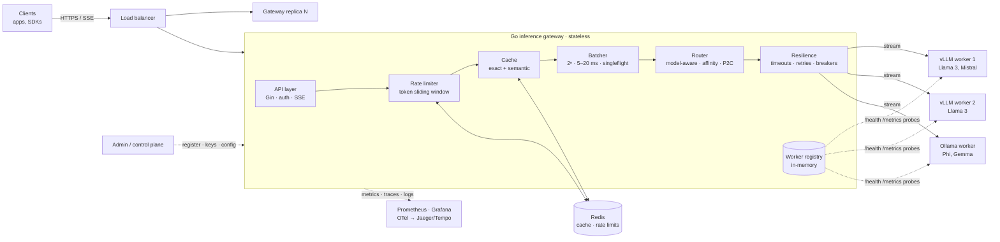

# Architecture

The gateway is a stateless Go service in front of a fleet of stateful GPU
workers. It exposes one OpenAI-compatible API and decides, per request, which
worker should do the work, and how to survive when that worker misbehaves.

## Request lifecycle

| Step | Package | What happens |
|---|---|---|
| 1. Accept | `internal/api` | Assign/propagate `X-Request-ID`, extract W3C `traceparent`, start the server span. Authenticate the API key (stored as SHA-256 digests). Decode and normalise the OpenAI request (string or array content, `developer`→`system`, `max_completion_tokens`→`max_tokens`). |
| 2. Resolve | `internal/catalog` | Map aliases (`gpt-4o-mini` → `llama3-8b`), apply per-model defaults, enforce the key's model allow-list, and 404 models no worker serves. |
| 3. Rate limit | `internal/ratelimit` | Reserve *prompt tokens + max completion tokens* against the key's sliding window (memory, or Redis + Lua for fleet-wide limits). Denials return 429 with `Retry-After` and OpenAI-style `x-ratelimit-*` headers. Actual usage is reconciled after the response. |
| 4. Cache | `internal/cache` | Deterministic requests (temperature ≤ `max_temperature`, or `X-Gateway-Cache: force`) check the exact tier, then the semantic tier: the final user message is embedded and compared, by cosine similarity, against entries in the same LSH bucket (plus 1-bit neighbours) **within an identical conversation and parameter namespace**. Hits replay as SSE. |
| 5. Coalesce | `internal/batcher` | Identical in-flight deterministic requests join one generation; followers receive the leader's chunks live from the first token. |
| 6. Batch | `internal/batcher` | Requests for the same model are held for at most 5–20 ms and dispatched as a power-of-two batch whose size adapts to arrival rate. At low traffic the target is 1, so nothing waits. |
| 7. Route | `internal/router` | Candidates are healthy workers serving the model whose breaker admits traffic. Sticky lookup (conversation → worker), then bounded-load rendezvous hashing on the shared prefix, then power-of-two-choices. See [routing](routing-and-kv-cache.md). |
| 8. Attempt | `internal/gateway` | Stream from the worker under a first-token timeout. Failures before the first token are retried on a different worker with full-jitter backoff; breakers trip on consecutive 5xx or latency breaches. Once a token reaches the client the request is committed. |
| 9. Stream | `internal/api` | Chunks are re-emitted as `chat.completion.chunk` events (or aggregated for non-streaming calls), with an optional usage chunk and `[DONE]`. |

## Components

### Worker registry (`internal/registry`)
In-memory, per gateway replica. Workers come from config (static) or register
themselves through the admin API (dynamic, kept alive by heartbeats, evicted
when stale). A prober polls every worker concurrently:

* **vLLM**: `/health`, `/v1/models`, and `/metrics` for
  `vllm:num_requests_running`, `vllm:num_requests_waiting`,
  `vllm:gpu_cache_usage_perc` (or `kv_cache_usage_perc`) and the prefix cache
  hit rate; GPU utilisation from `gpu_utilization` or DCGM if exported.
* **Ollama**: `/api/tags` for servable models and `/api/ps` for models resident
  in VRAM, so the router can avoid multi-second cold loads.

The registry also keeps a TTFT ring buffer per worker (p50/p99) and the
worker's circuit breaker.

Worker load is `max(local in-flight, worker-reported running + waiting)`:
worker-reported numbers include traffic from every gateway replica, the local
counter reacts between probes, and taking the max avoids double counting.

### Resilience (`internal/resilience`)
* **Timeouts**: whole-request timeout plus a per-attempt *first-token* timeout
  implemented with `context.WithCancelCause`, so a stuck worker is abandoned
  after e.g. 15 s even though healthy streams may run for minutes.
* **Retries**: only before the first byte reaches the client; exponential
  backoff with full jitter; each retry excludes workers that already failed.
* **Circuit breakers**: per worker; open after N consecutive worker faults
  (5xx, connection errors, first-token timeouts) *or* N consecutive calls whose
  TTFT breached the latency threshold; half-open after a cool-down with a
  bounded number of probes. Client errors (4xx) never trip a breaker.

### Control plane (`internal/admin`)
Protected by a bearer token:

| Method | Path | Purpose |
|---|---|---|
| `GET` | `/admin/v1/workers` | Live registry: health, breaker, load, KV usage, TTFT p50/p99 |
| `POST` | `/admin/v1/workers` | Register a worker |
| `POST` | `/admin/v1/workers/:id/heartbeat` | Keep a registration alive (404 ⇒ re-register) |
| `DELETE` | `/admin/v1/workers/:id` | Deregister |
| `PUT` | `/admin/v1/workers/:id/assignment` | Models a worker should load |
| `GET` | `/internal/v1/worker-config/:id` | Worker pulls its assignment at startup |
| `GET/POST/DELETE` | `/admin/v1/keys` | API keys (raw key shown once) |
| `GET/PUT` | `/admin/v1/models` | Model catalog and aliases |
| `GET/PUT` | `/admin/v1/limits` | Default per-key limits |

The YAML config is also hot-reloaded (polling, so Kubernetes ConfigMap symlink
swaps work); invalid edits are rejected and logged without affecting traffic.

## Why the gateway can be stateless

Everything a replica knows is either reconstructible within one probe interval
(registry), shared through Redis (rate limits, response cache), or derived
deterministically (rendezvous hashing gives every replica the same placement
for the same prefix, so replicas agree on where a conversation's KV cache
lives without talking to each other). The sticky table is a per-replica
optimisation on top of that, not a source of truth. Replicas can be added,
removed or restarted at any time.

## Scaling

* **Gateways** scale horizontally behind any L4/L7 load balancer
  (`deploy/nginx.conf`, or a Kubernetes Service + HPA on CPU).
* **Workers** scale independently per model pool (one StatefulSet per model).
  New workers register (or appear in config), get probed, and start taking
  traffic; rendezvous hashing moves only ~1/n of prefixes to them.
* **Adding a model** is a worker change, not a client change: start workers
  that serve it, optionally add an alias in the catalog, and clients call it
  through the same `/v1/chat/completions`.
